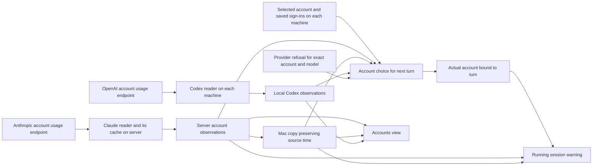

# Account allowance authority: incident, full flow, and proposed contract

Status: source and live-account audit in progress; independent ChatGPT Pro review received. The narrow warning correction is installed; the wider contract below is a proposal and a candidate change, not yet fully installed or accepted.

## Requirement and incident

Tejas asked why a 3:48 PM running-session warning said Claude was above 90% while Accounts showed about 10%, and asked for one queryable source of truth across account views, session decisions, and notices. He clarified that both Mac and server keep multiple saved Claude and Codex accounts, while each machine presents one selected account for each provider at a time. He asked for the whole flow, its delta, a sustainable proposal, and a ChatGPT Pro second opinion.

The current separation between a selected Claude account and the account actually used by a turn is intentional. The former shared-credential switch overwrote a credential file while sessions were running and broke accepted work. Separate account homes let a turn use another account with room without changing a live credential. The account choice record cites Tejas's September 23 direction not to wait for a refill while another account has room and his September 29 direction not to announce routine account moves (`provider-account-choice.ts:1-28,169-180`). One selected account in Accounts therefore does **not** mean only one valid Claude sign-in exists on that machine. Codex differs because one shared App Server login runs its turns, and the owner refuses a switch while Codex is working (`session-execution-host.ts:507-534`).

The verified 3:59 PM production backup retains the source readings as of the 3:48:39 warning. The personal Claude account was 10% weekly from 3:42:02 (6m37s old); the chann.app account was 100% weekly from 3:45:19 (3m20s old). Both warned sessions were bound to the personal account. The old new-work calculation excluded the older personal reading under its six-minute rule, chose the remaining chann.app candidate at 100%, and reused that candidate score in the running personal-account brief. The phrase “at or above 90%” was fixed threshold wording, not a 90% measurement. A later 3:49:42 personal read still showed 10%. No provider refusal is required to explain this discrepancy. The exact 3:48 provider state after the 3:42 personal observation remains unobserved; 10% was the latest recorded observation, not a live 3:48 query.

Reproducible incident evidence: the read-only backup is `/root/.local/state/concierge/backups/state.pre-deployment-repair.1792007911203.db` (SHA-256 `be7a15e00b546a73ebd019f1eb9944ac9a376a13cfb435630c82fdf1533cd36b`, 3:59:50 PM). The executing release manifest at the warning was `/var/lib/slack-concierge-deployment/releases/cdf7307fe60c69d8c1325720e793184819534bf6f272bae9ba95e38d708110dd/manifest.json`, commit `3b5bb712e8d89b86ba17c2418f636a0325670182`; the same owner PID appears in the 3:48:39 journal and an earlier stack trace from that release. In the backup, `provider_usage_readings` filtered to Claude/Weekly and the latest observation at or before 19:48:39 UTC returns personal 10% at 19:42:02 and chann.app 100% at 19:45:19. `executions` for turns 8815 and 8822 records personal as both execution accounts; `turns` records Opus for both. `session_owner_events` sequences 595390 and 595391 contain the exact accepted warning text, and the journal records both briefs at 19:48:39.905/19:48:39.920 UTC. The backup is later than the incident, so these claims use historical keyed rows and event/turn records, not merely its latest snapshot. A durable sanitized copy of these rows has not yet been separately archived; backup retention may remove the original file.

The installed warning correction now uses the running turn's recorded account, the same stored account reading the Accounts view receives, its actual percentage/window/source time, and a one-minute maximum source age. The old warning's mixed-account path is closed. That narrow correction does not establish the whole allowance decision flow.

## Current system map

The diagram shows data movement, not equal authority: a copied reading remains the provider's earlier observation, and account selection and a provider refusal are different facts.

| Step | Server | Mac | Authority and observed boundary |
| --- | --- | --- | --- |
| Saved sign-ins | Multiple Claude account homes and multiple Codex profiles; one account selected for agents per provider | Same saved profiles; one selected per provider | Account selection is local machine state. A saved Claude home can be a valid sign-in even when it is not selected. Codex execution uses the current shared App Server login. `provider-accounts.ts`, `provider-account-dispatch.ts:180-197`, `session-execution-host.ts:507-575` |
| Provider reading | `cswap` obtains Claude usage from Anthropic's OAuth usage endpoint and may return its last good value under a poll plan; CodexBar reads each stored Codex home | CodexBar reads local Codex profiles; Mac Claude rows may be borrowed from server | Provider account/window value is the upstream observation. A new account-list pass is not necessarily a new upstream reading. `provider-account-usage.ts:206-312,459-504`; installed `claude_swap/oauth.py:364-373`, `switcher.py:4815-4905` |
| Retention | Latest per-provider snapshot and bounded account/window history | Own latest snapshot; borrowed rows keep peer source time | `observedAt` is the local pass time. `readAt` is the original provider reading time. They must not be substituted. `provider-account-usage.ts:485-505`, `provider-usage-forecast.ts:83-125` |
| Accounts | Lists saved profiles, selected account, windows, problems and source times in its response | Same local view; may contain peer-sourced Claude readings | The page is a view of stored readings, not a live provider guarantee. Claude/Codex rows remain visible when stale. The “another account has room” sentence currently ignores source age. The Thinkering client omits per-account `readAt` from its type and bars; its “Last checked” refers to the saved account-list response, not the provider's source reading. `provider-auth-read.ts:12-21,43-80`; Thinkering `browser-session-client.ts:253`, `provider-accounts.tsx:111,229,471` |
| Automatic new session | Evaluates launchable accounts whose provider and per-account reading are at most six minutes old; Codex current account only; chooses provider by remaining allowance | Same policy with local selection and homes | This is a *candidate/launch policy*, not a usage measurement of an existing session. `provider-start-choice.ts:14-50,106-138`, `provider-account-dispatch.ts:199-229` |
| Claude turn | May run from a saved Claude account home other than the selected one; records actual account with the execution | Same | Current turn-time chooser ranks stored percentages without checking each reading's age. Its comment says stale readings cannot justify moving, but the source path does not enforce that. `provider-account-dispatch.ts:258-319`, `turn-execution.ts:592-658` |
| Codex turn | Uses the shared App Server's current account; switching is refused while a Codex turn runs | Same | One currently executable Codex account per machine. Saved Codex profiles have readable usage but cannot run until selected. `session-execution-host.ts:507-534`, `codex.ts:1611-1613` |
| Refusal and holds | Actual provider usage/model refusal is retained by attempted account/model; matching holds can release after a proven reset, account change or exact manual check | Same | Provider admission is a separate, newer fact than a usage percentage. A 12% bar does not prove that a chosen model will accept a turn. `provider-usage.ts:41-78,123-224`, `provider-account-usage.ts:513-547` |
| Saved/banked work | Chooses a fresh, specific account/window and pins it to a reset boundary; running banked work checks its reserve | Same | Banked work has stronger account binding than ordinary Claude turns. `saved-work.ts:97-128`, `session-runtime.ts:48-74` |
| Notices | Account warning and running-session brief require the account's own source time within one minute; warning names account/window/percent | Same | This is the corrected narrow contract. Combined provider warnings separately name both candidate accounts. `provider-usage-forecast.ts:254-270`, `provider-start-choice.ts:73-102`, `provider-usage-notice.ts:336-445,544-590` |

Live read at about 4:37 PM ET: both machines listed both Claude and Codex profiles as saved. The server selected personal Claude; the Mac selected chann.app. The Mac's selected Claude row was peer-sourced and carried a 4:27:40 PM provider time even though its Accounts response was produced about 4:36 PM. The Mac's 100% row was therefore a historical observation at that moment, not a fresh claim. A later provider reading may change this state; preserve the source time when reporting it.

## Confirmed delta from the desired rule

1. The installed warning fix binds its percentage to the running account and source time. It does not change the turn-time Claude chooser. That chooser can rank a stale saved account as having room, then learn the truth only through a provider refusal.
2. The Accounts response keeps Claude/Codex percentages visible when old and can say another account has room from an old reading. The source time is in the data, but the sentence does not use it.
3. “Which account is selected?” and “Which account this Claude turn will use?” are separate local facts. A provider-wide percentage without account and allowance-window identity is undefined. The default human usage query should mean the selected account; an execution or notice must mean the account bound to that turn; an all-accounts comparison must name each account.
4. `cswap` has its own poll plan and last-good cache. Concierge's three-minute collection interval is not proof that each account was fetched from Anthropic three minutes ago. Every consumer must use the source reading time and status.
5. Model admission refusals and credential health cannot be inferred from a percentage. The contract must expose them beside, not inside, the usage measurement.
6. Thinkering displays “Last checked” from the saved page response and omits each account's provider read time. That makes a refreshed page look current even when a row is a borrowed or cached older observation. The user-visible contract needs the same source time as the owner policy.
7. A 100% included-usage bar is not always a provider refusal: Anthropic can continue on paid usage credits when enabled, while Concierge conservatively treats the included allowance as spent. The usage observation and the system's spending policy need distinct names; no proposal here silently authorizes paid overage. The live personal Claude account reported usage credits off; the other account's credit state was not established by that read.

## Proposed invariant and query

One account/window observation has exactly one identity and origin: `{provider, account, window, usedPercent, resetsAt, sourceReadAt, sourceMachine, sourceStatus}`. The source is the provider response, normalized once by its reader; a peer may copy the observation but may not replace `sourceReadAt` with transfer or page time. Account selection and session execution binding are separate records. A model refusal is an additional `{provider, account, model, refusedAt, retryAt}` fact. No policy manufactures a percentage from the choice it made.

One owner query evaluates these facts for an explicit purpose and account: `display-selected`, `display-account`, `new-work`, `turn-start`, `saved-work`, `running-warning`, or `hold-release`. It returns the measured observation (including age) and a distinct eligibility result `ready | held-until | unknown | signed-out`, with the evidence behind that result. A caller cannot get a bare provider percentage. An absent, invalid, mismatched or too-old observation is `unknown`; it is never zero and never a fresh 100. Each decision sets its maximum age in the shared policy, with one-minute human warnings and a bounded new-work window retained unless a measured reason changes it. A turn can use a saved alternate Claude account only after the query establishes that exact account's current login and allowance; the execution record then binds that account before any notice or hold is computed. Re-evaluate at launch if selection or reading changes between choosing and sending.

For Tejas, Accounts shows the selected account's percentage and “last checked” time by default, while still listing named saved accounts. A session shows the account it is actually spending. A stale row remains history labelled “last checked”; its room sentence becomes “allowance needs checking” rather than declaring capacity. A warning states only the measured account/window/percentage/time. A refusal states that the provider rejected the exact model/account, even if a bar previously looked available.

This can be implemented in the existing owner and stored usage tables on each machine. It does not need a new global server or credential store. The machines may have different selected accounts, while copied usage evidence for the same provider account keeps the same source identity and time.

## Alternatives and reason

| Candidate | Benefit | Cost or failure |
| --- | --- | --- |
| Keep patching each call site | Small immediate diff | Every consumer can reinvent freshness and identity; this incident and the remaining stale chooser show the recurrence. |
| One server-only percentage/cache for Claude and Codex | One physical store | A provider still has multiple accounts/windows, and the Mac's executable sign-in is local. Server sleep/failure or network loss would make the Mac dependent on it; centralizing numbers alone cannot prove model admission or Mac credentials. |
| Shared account-observation and eligibility contract in each local owner, using existing peer copies | One rule for meaning, freshness and source identity; keeps Mac's local execution authority and current peer transport | Requires migrating all consumers and proving same contract on both machines; snapshots can differ in time and must say so. |
| Selected-account-only Claude execution | Aligns a simple mental model | Drops existing saved-account capacity; still needs source time, model refusal and window identity. It is a routing policy choice, not a substitute for the observation contract. |

The third candidate meets the objective with existing processes and storage. It keeps a selected-account default for human queries and makes every deliberate alternate account explicit in the work record. The independent ChatGPT Pro review supports this direction but found further paths that must retain account and decision identity.

## Independent ChatGPT Pro review and work still required

The reviewer independently traced the source at `eb75ff5e` and the warning changes in PRs #129 and #130. This was a source audit, not a live dual-machine acceptance check. Its independent source finding agrees that the original warning substituted a new-work routing score for a running account observation; the verified production backup above provides the incident-specific 10% and 100% readings the reviewer did not have.

The review found these additional concrete gaps. The opening agent brief can be built before an ordinary Claude turn chooses its actual account. A usage-refusal notice can use the selected account instead of the account on the failed attempt. A peer copy can lose to an older local reading merely because a local row exists. A model-specific refusal can be treated as whole-account exhaustion. Early-reset evidence can race with a late refusal; provider-wide hold release and resolution wording can overstate what one account or a clock has proved. Banked-work safety stops currently group stale evidence, boundary end, and spent allowance under one cause. Codex reset-credit outcomes can classify an ambiguous transport result as success or no spending. Forecasts from the Claude reader are estimates, not provider guarantees. A credential-home check may run a model and tools, so it must not be described as a passive usage read.

The candidate source-timed evaluator covers ordinary room decisions, warning freshness, Accounts status, saved-work planning and model-specific Claude windows. An additional bounded correction is being made for opening-brief/refusal attribution and peer observation choice. The reset-credit outcome correction is also a candidate. This candidate does **not** yet implement durable decision records, per-scope refusal generations, exact-account hold reevaluation, or distinct banked-stop causes. Those remain required before claiming every allowance decision shares one end-to-end contract. Do not describe this candidate as complete just because its build passes.

The acceptance trace for the remaining work should show, for each action, the account selected, the account and model actually attempted, the exact window observation and source time, any later provider refusal, the decision made from those facts, and the outcome observed. A release means eligible to retry; only provider admission means resumed. An uncertain reset-credit response must remain uncertain until reread against the provider.

### Second Pro challenge to this proposal

The reviewer then checked the draft against source at `06fb2f55` and narrowed several claims. Before the candidate, six-minute checks could substitute the batch time for missing per-account source time; they did not establish all required windows. A retained last-good Claude value could be paired with the wrong fetch timestamp. The Accounts sentence could promise that new work *runs on* another account from percentage alone; owner and isolated-reader versions differed in how they considered refusals. The collector refresh path also performs home proofs, cache clears and queue release, so a pure eligibility query must not inherit those effects. These are source findings, not live proof of every failure scenario; the candidate addresses some, and the collection path is under separate live investigation.

The intended contract therefore has three linked answers rather than one overloaded status: **observation** (account and quota bucket, value, source time, latest fetch attempt and provenance), **local capacity decision** (whether this machine may attempt the requested model under a named policy, including credential and refusal evidence), and **work decision** (whether this exact input may start, retry, continue or remain held given its execution history and user controls). A stale observation cannot erase a newer refusal; an unknown reading can still permit a deliberately bounded attempt when identity is verified and policy allows. Automatic alternate selection requires fresh evidence; unattended banked work requires a fresh reserve observation. The evaluator is pure over a coherent snapshot. Collection, home proof, credential activation, queue release and notices remain explicit owner actions.

The normalized identity should eventually include a verified provider account and subscription or organization, a quota-bucket identifier and the local credential/runtime generation. Email and profile labels remain display and lookup aids, not cross-machine identity proof. A failed fetch is recorded separately from the last good observation. A provider reset time, a local retry-not-before time and a model-capacity cooldown are different fields. One provider/account plan should be carried from automatic choice through launch, then revalidated before admission and retained for incident replay; today provider scoring and Claude account ranking are separate policies. Unknown outcome after a credit request needs a durable action identity and reconciliation before any repeat spend.

The remaining consumer inventory includes Codex automatic account rotation, delegation advice, initial and periodic briefs, threshold and refusal notices, cross-provider recovery, side questions, banked stops, reset credits, and both native/runtime compositions. Each must read the same meanings, but work safety and user Stop/Pause remain independent authorities. A future release gate should refuse a new allowance consumer that bypasses the pure evaluator; a paired Mac/server trace should prove installed wiring, not merely shared source.

## Acceptance before claiming whole-system reliability

- Historical replay: at 3:48, personal 10% observed 6m37s earlier and chann.app 100% observed 3m20s earlier; neither running personal session receives a 100% warning, and the stale 10% is labelled with its time rather than asserted current.
- Cross-account case: selected chann.app 100%, running personal session 12%; the selected-account view says chann.app 100% with source time, while that session's warning is based only on personal. A new-work route identifies which account it will use.
- Peer case: the Mac receives a server reading nine minutes old; its source age remains nine minutes in the Mac view and no room decision or percentage warning treats the transfer as a refresh.
- Decision case: an alternate Claude account with stale 12% cannot be chosen on that stale percentage; a fresh reading or a provider-confirmed launch/refusal settles it. A Codex saved profile cannot be treated as executable until its shared App Server selects it.
- Refusal case: a fresh low percentage plus a newer exact-model refusal remains held until provider success or a proved reset; the visible reason names the refusal rather than silently rewriting the percentage.
- Native installed check: on server and Mac, inspect selected sign-in, all saved accounts, exact source times, bound execution accounts, Accounts text including each row's provider read time, and a marked agent test path after release activation. Do not induce a costly high-limit notice merely to satisfy a test.

## Evidence limits

The historical backup proves the old warning's account mixup and the current source audit proves the listed code paths. Current live reads prove account inventories, selections, peer provenance and observation times at the stated instant. They do not prove every possible launch or provider response. No new high-threshold notice was induced. The independent ChatGPT Pro review is source-level only and did not retrieve the backup or perform live dual-machine validation.

Anthropic's [Max plan documentation](https://support.claude.com/en/articles/11049741-what-is-the-max-plan) names the five-hour and weekly limits, and its [reset documentation](https://support.claude.com/en/articles/17007452-what-is-a-limit-reset) says usage limits are shared across Claude and Claude Code for an account. OpenAI's [Codex plan documentation](https://help.openai.com/en/articles/11369540-using-codex-with-your-chatgpt-plan) describes the account's Codex usage and resets. These provider documents establish the account/window scope. They do not document Concierge's account homes, cache freshness or decision policy; the local source and retained observations establish those claims.
Anthropic's [usage credits documentation](https://support.claude.com/en/articles/12429409-manage-usage-credits-for-paid-claude-plans) explains why included usage percentage and provider admission can diverge when paid credits are enabled.
